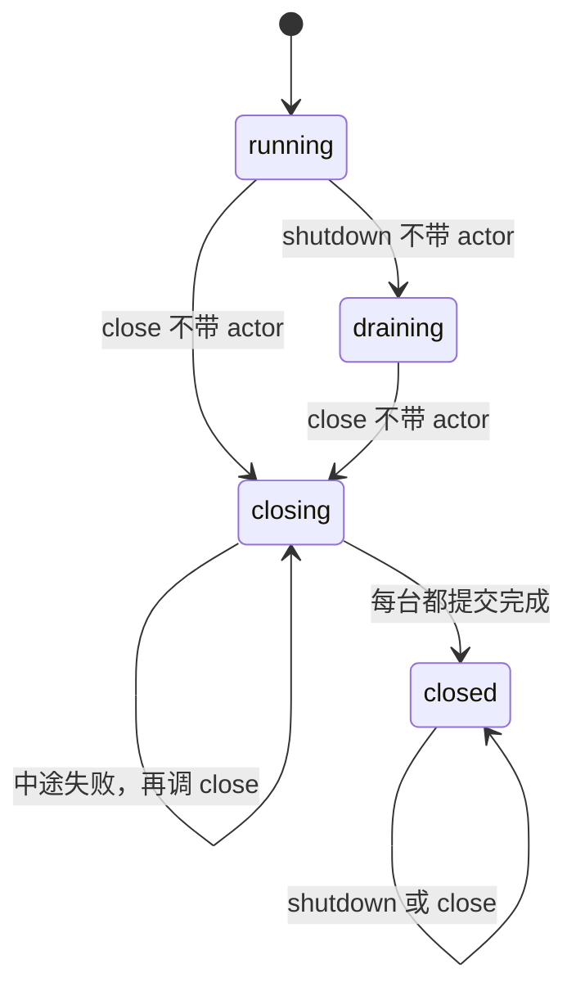
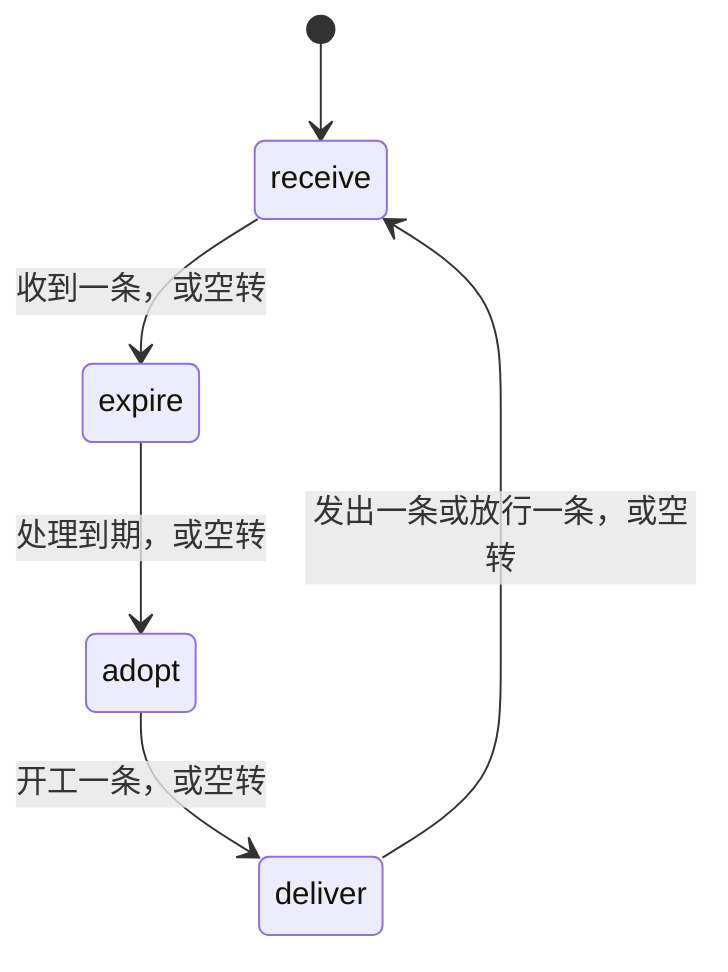
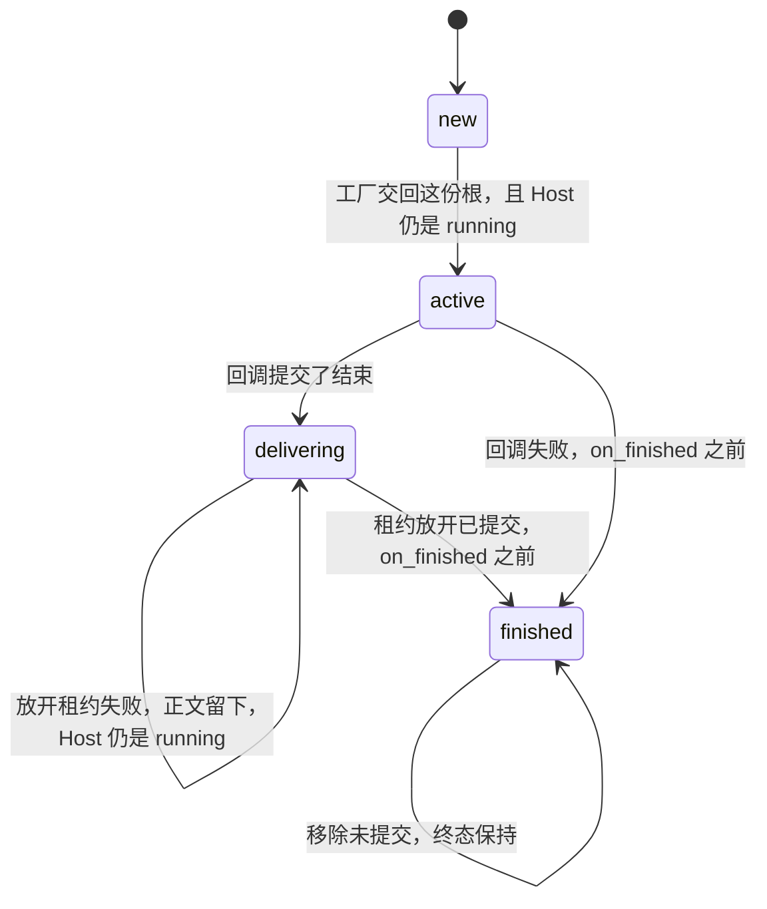
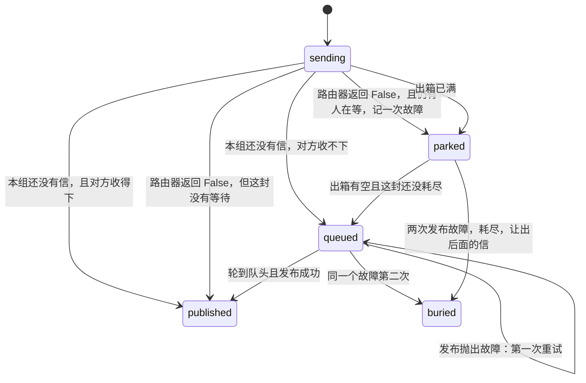
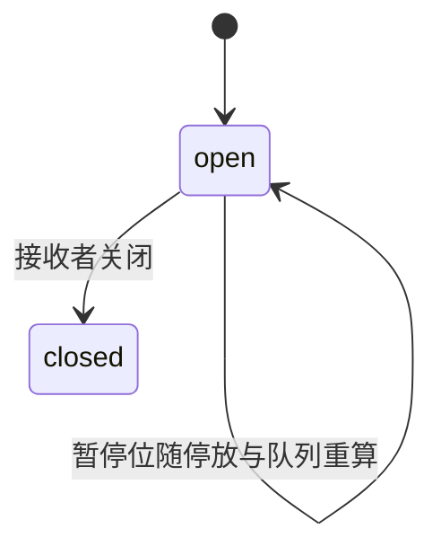
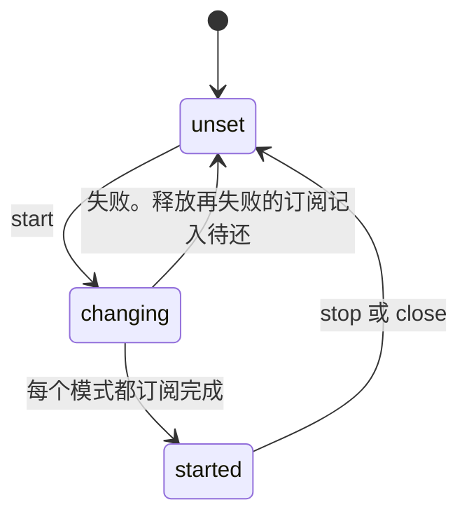
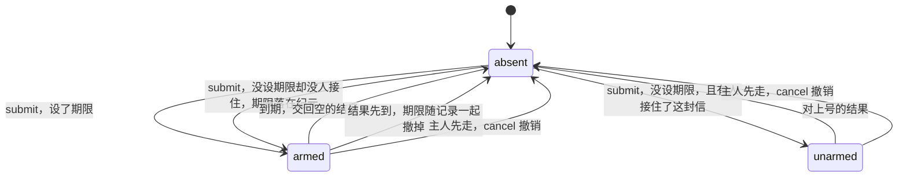
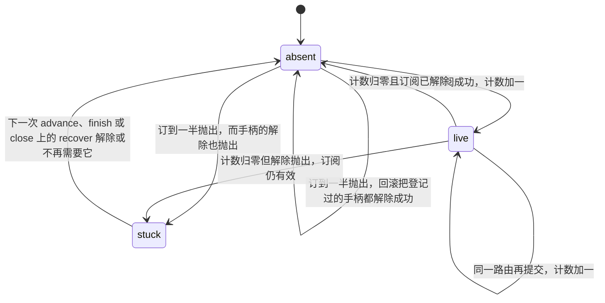
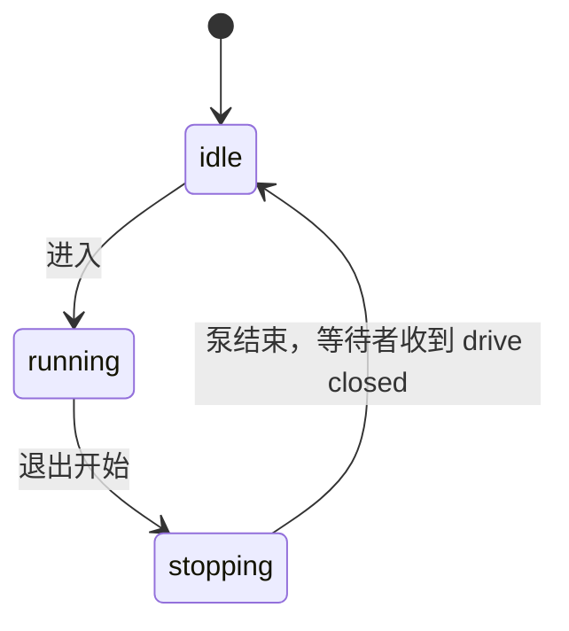

# 状态机

每台机器只用自己的枚举说话，转移写在边上；名字下面若还能乘出第二种行为，记在该节末尾。运行时是单写者：下面的边都在同一次调用里发生，没有第二套并发状态。

## Runtime

| 状态 | 进入 | 离开时的事实 |
| --- | --- | --- |
| running | 构造 | `add` 可以接入。`advance` 只推进 running 与 draining 的 Host |
| draining | 只有 shutdown | `add` 拒绝。已有工作继续推进 |
| closing | close 不带 actor，先于任何一台的提交 | `add` 拒绝。每台已 begin_close，`advance` 跳过它们 |
| closed | 全部 Host 提交完成之后 | `add` 与 `advance` 都拒绝 |

`shutdown(actor)` 与 `close(actor)` 不改 Runtime 这一层；`shutdown` 在 closing 或 closed 上直接返回，不退 draining——退回等于让一台交完名册的运行时重新开得动，或替一次没关完的关闭改口。
close 不带 actor 时先写成 closing、对每台 begin_close，然后才逐台做会失败的释放；已提交成功的停在 `closed` 并留在表里，全部成功才摘掉。中途失败的那一轮里每台都已交上关闭的心跳，名册上一台 running 都不许留。摘的时候要摘干净：期限与就绪早被投影盖平了，最后这一步还须把叫醒的那只把手一起抽掉——留着它，名册上就还认得一个已经不存在的名字。全部成功之前名册整个留着，下一次关才把名单交干净；已经关完的运行时再关只答一份空名单，不重走任何一台。
`add`、`advance`、`close` 与从外面调用的 `shutdown` 各占一把忙锁，忙锁还在时再开报 `closed or reentrant runtime`——closed 这一格里 `add` 与 `advance` 撞的也是这一句，它答的是「写者已经走了」，不是「状态不对」。一轮只有一个写者：轮次开着的时候，从别人的代码里再开第二轮、再进门，都在这把锁上被挡回去；读数没结束的时候同样挡——读的那一步里把一台 Host 订上名册，外面那一轮接着走，手里的名册就不是它开始推的那一份了。只有从外面调用的 `shutdown` 沿用这一轮。
一轮只读一次钟：`advance` 开门时读到的那个瞬间留在这一轮里，轮次里谁问 `schedule()`，答的都是它；出了这一轮才认新数。叫醒的那只手自己坏了，故障记在名册上，由走完的那一轮兑一次 `WakeError`——一笔故障只兑一回，第二轮不许再响。

归属：交给 Runtime 的 Host，其推进、排空、关闭、投影只发生在这台 Runtime 自己打开的轮次里。核对认调用者的代码对象——`add`、`advance`、`close` 与这条链上的代码对象在导入时烘焙进 `require`；已交出去的 Host 另记着准入它的那一只运行时，两道都对上才让写，都不对上报 `runtime is the only writer`。归属是不可变快照：旧主人被回收，已交的记录还在，第二台写不动它，出路只有对它自己 `close`。一台 Host 出生就在「没交出去」那一格占一位，主人死了不还；正主再出生会把它清干净——陌生对象借这个位最多骗过 `admit` 那一句，屋里 `core_of` 是第二道，两道都不许它写成别人的账。`admit` 自己问两格：已认领的、没交出去的，里面有没有它；两格由先摘后放守住互斥，前一问平时因此不出声——把名册当场折成两格重叠必须拦得住，互斥本身也走一遍出生、准入、交还。
没交给运行时的 Host 仍自己 attach、advance、withdraw、close。

`add` 的拒绝不止进门问一次状态：准入会跑别人的代码，其中任何一步里有人 shutdown，这一步就倒着走完（不再拥有这台 Host、划掉 Agenda 上的账、松开 Signal、退掉刚订上的路由），退回的 Host 没有订到一半的路由，也没有「没人拥有却还认得主题」的收件箱。例外只有一处：路由当场退不掉（租约 stuck）时两笔一起报，欠账由应用在下一次 `close` 或 `advance` 上替它还。shutdown 若在 attach 之后才打中它，它带着 draining 回来。

## Host

| 状态 | advance | admit |
| --- | --- | --- |
| running | 四相轮转 | 接受 |
| draining | 四相轮转，新根以 `host_draining` 拒绝 | 报 `host draining` |
| closing | 整台跳过 | 报 `host closing` |
| closed | 跳过 | 报 `inbox closed`：关闭连同收件箱一起关掉 |

`cancel` 在 draining 仍可做，closing 与 closed 都报 `host closing`。`admit` 先问收件箱再问状态。
`admit` 与 `cancel` 都是「开一轮」的动词：轮次已经开着的时候，两者都先报 `reentrant host execution`，不等到里面才撞。
`admit` 自己的值也自己答：期限是不是负数、主题读不读得开，都由这一步说，不由后面领号的那一步代说。
认手的动词有十个：bind、unbind、notice_closed_inbox、drain、begin_close、close_owned、take_abandoned、project、delivery_spent、resume_held——交还出去的那一只手松开之后，连原主也写不动它，别人更不能。
`resume_held` 只答两样：这笔等待在不在我身上；在就顺手续上，此刻续不上也照样应下来——应下来就不许再由别处补答一遍。
续上这一手认 running 也认 draining：排空只是不再接新根，手里已经应下的那笔仍要当场办完；只问 running 的那一半，draining 就成了「应了却不动手」，那一封既没结清谁，也没人再替它说话。走进 closing 才是应而不做。
锁是「一台 Host 一次只允许一个轮次」：轮次开着再开一次撞 `closed or reentrant runtime`；在门外从钩子里推进自己这一台报 `reentrant host execution`。
一封已受理的信有三个落脚处（作业、收件箱、开工队列），`cancel` 按序问这三处：已开工的当场交回 `cancelled` 结局且要占一格；没开工的只下记号；三处都问不到返回 false。
关闭的提交顺序：begin_close → 按各自结局处理（未交结局的 `on_rejected` 只通知一次，再释放租约；已记正文未放租约的，释放成功的同步调用 `on_finished`）→ 排空开工队列与收件箱 → 确认账本空、无未释放租约 → 把出箱交出去。
走到 closed 这一格，作业、账本、出箱、收件箱这四本账都是空的：第二次 close 只把名单原样交回，不重走其中任何一步。
关到一半坏掉分三种：结局钩子抛出——那一笔已经结清，关仍然走完，名单留在桌上，由下一次 close 拿走；租约当场解不开——停在 closing，作业留在手里、信不进名单、那句交还不说第二遍；两样一起——抛出的一束里两笔都在。
「交还」是交接责任：`Runtime.close` 把名单交给调用它的人，此后这些信由应用安置；通知只给关闭开始时已有的信，每封恰好一次。
`finish` 正文已成立而放开租约失败时，Host 保持 running，作业带着正文留在 delivering，之后每次 advance 先再试放开；进入 closing 只来自 `close`。
谁能走进这台，只由订阅那一条路决定：`patterns` 之外没有第二份收信名单，入队与开工那一步只问这台还在不在 running。

## 四相

每台 Host 有一个相位游标，0、1、2、3 循环。一次 `advance` 的预算按这台 Host 单独计算，回调耗时不占预算。预算只在不空转的那一格花掉：空转连着四格就收，预算花完也收，两种收法都停在出发点——下一圈从同一相接着轮转，谁也不许多走一格把别人挤到后面。

| 相位 | 标志 | 做什么 |
| --- | --- | --- |
| 0 receive | READ | 取一条。结果进入续作；diagnostic 丢掉；其余进入开工队列或当场拒绝 |
| 1 expire | TIMER | 取一个到期等待 |
| 2 adopt | WORK | 从开工队列取一条根并执行 |
| 3 deliver | DELIVERY，或有可重试的停放回信 | 发出队头，或把 pending、rest 里还能发的回信放进出箱 |

有停放回信时相位 2 让路，相位 0 只收结果或入队，不执行；让路的那一相按空转记账。
相位 3 由两只手开门：「到点该重发」与「有人盯着一个位子」。出箱的名单与 DELIVERY 旗同起同落；两只都闭着的时候问与不问落回同一个 idle——「每到这一相都去看一眼」不是一条法律。
押着回信而开工队列又满时，相位 0 什么都不掏：掏出来再放回去是白转一圈，放不回去就是丢一封信。
押着回信的这一相先收结果：从满箱里抽走一格，要叫一次替别人守格子的人；箱被读空才把 READ 放下——还剩信就不许提前放。
不受理与正在排空时，入队与开工问同一次。队列满只在入队时追加，开工满只在取根时追加——队列里的根没有等待方，这句回答由泵自己说。
diagnostic 不入队、不拒绝、不续作；快照做不成才留给 close。
旗亮着而手里没有信——读空的箱子、关掉的箱子、取空的队列——那一相就答 idle：假旗不许白转一圈。
开工一条就是给这个 root id 立一份工，同一台 Host 上只允许一份；重播的第二封与其他开不了工的信同样先按 `adoption_failed` 就地回答。
工厂违约不改变这一句：作业没交上来，这一封仍按 `adoption_failed` 就地回答，工厂那一刀照原样离开这一轮——回答与抛出各算一次，谁也不盖谁。
被拒的信先答后通知：答不出去，`on_rejected` 仍然要说；两样都坏才并成一束。
该不该被推进、这一轮押没押信、账上还剩没剩东西，是同一台 Host 的三个纯判断；把门让开是第四个。

## Job

| 状态 | 在 jobs 里 | on_finished |
| --- | --- | --- |
| new | 否 | 未进入 |
| active | 是 | 未进入 |
| delivering | 是。回信可能停在 pending，`pending_control` 持有结束体 | 未进入 |
| finished | 钩子进行时在；移除提交之后不在 | 进入时 `finished` 已为真 |

成功回信一旦进入 pending、rest 或出箱，`replied` 就为真；失败回信同样。
回调进行中 `Context.finished` 表示这一次回调已请求结束；`Job.finished` 在生命周期写成 finished 之后保持为真。
同一次回调里 `finish` 之后再 `request` 报 `job already finished`；`finish` 之前发出的 `request` 随 `finish` 一起作废。
跨回调也算同一只手：结局写在 State 上，buffer 一轮一份，所以下一轮的 `request` 与 `reply` 撞的是同一句「已经收过尾/答过一封」——两只手都在门口，只问本轮那一只，另一格就答「还能写」。
回信和收尾共用一份正文：`reply` 写下的映射就是 `on_finished` 看见的那一份。
回调自己抛出时先把生命周期写成 finished 再调用 `on_finished`，这份 `job_failed` 回信与收尾共用。
撤账撤不动也不回头改写结局：这台当场转入 closing，钩子的错与租约的错并成一束冒给驱动者，作业带着 finished 留在表上，直到 `close` 收走它。
答过一封之后才坏的钩子不再补第二封：`job_failed` 只进 `on_finished`，出门的回信仍是那一封。
失败那一封被收件的一方拒收：信押在出口上，`replied` 为真，作业却已经移出，拒收的那一刀冒给驱动者；下一轮补发，只补一次，结局也不再宣布第二遍。
封存也走 delivering 这条边：还没交上结局的作业先挪到出口上，再撤掉它名下未答完的段。
结局只差租约放开时也停在出口上：`pending_control` 记下正文，还没发出的那一封当场发出，发过的、或本来就无信可发的（事件）都不再发第二遍；`on_finished` 等到租约真的放开的那一刻才宣布，只宣布一次。
「这一笔结局还押不押着段」只由一处回答（`waits_for_book`）：该不该被叫、要不要补放、留下的结局能不能结清，三处读同一个答案，第二处不许自己再摆一次条件。
补发放不开就留在原地：这一轮不算推进，也不提前宣布结局；补发时钩子坏了，这一刀交给驱动者——作业已经移出，不会有第二遍。

钩子既不回信也不发起请求、账上也没有还在等的段时，`_silence` 替它补一份 `job_silent` 的错误答复——这一份同时就是 `on_finished` 看见的那一份正文。它在三处停手：根不是 request；`replied` 已经为真；自派自的根在账上已经没有这一笔。停手不等于没人回答：event 的结局照样要交，作业照样移出。
`Context` 只在那一次回调里动手：写下结局之后再 `request` 报 `job already finished`，同一只手同时写两封报 `reentrant Context mutation`。

## 回信与出箱

名字：sending 这封正被递出去；queued 已进本组队列等轮到它；parked 被拒后停在组外等出箱有空；published 已经落地。

组内还活着的信保持进入顺序，一次放行一封：前一封落地之前队头不动。buried 离开活队列，仍计入 `unsent_count`，只记名一次。
耗尽落在组头那一封身上时，整组跟着这一步走：组里还有下一封就把名字挂回待发名单并叫醒一次；组空了就整组散掉、旗一起放下——名额始终算给还没发出去的信，埋没的那一封只等关闭交还。
相位 3 排空时抛出故障：第一次记在这封信名下、退回候选等下一相，而这一刀仍然冒给这一轮。
背压与故障是两条不同的边：收件箱收不下只让这封信回到候选，一次也不记；抛出来的故障走「两次即埋没」；`publish` 明确返回 `False` 且仍有人在等才算没人接住，返回 `None` 按已投递。
谁在等只有一处说得出：`waiting(None)` 恒假，没挂上号的请求也不算有人等。
尝试次数是派生的：在 `attempts` 里且不在 `again` 里就是耗尽。
落不了地又耗尽的结果由运行时结清：名册走一遍，押着这笔等待的每台各结自己那一笔——不漏第二台，不对同一台结第二遍；一台都不押着时把这一定论交给总线，等待方在另一台运行时里就地落地。这一刀仍然要冒给驱动者——吞掉它，没人知道投递坏了。

出箱三张账彼此对得上：`size` 等于还留在组里的信加上埋没的信；候选表上每个主题对上一个未空掉的组；空组不留在表上。
定论走另一条路：放得下就不上未交的名单，`_place` 落地的这一次之后不许再落第二次；放不下才挂上名单，等到位子再走一次，落了地就松手——还塞不进去的那一次要继续挂在原处。

## 收件箱

接收者：未认领、已认领且有效、已移交、已关闭。一个收件箱只有一个有效接收者，关闭后不能再认领。箱号只加不减，一个号在一台进程里只属于一只箱子：名册上认得这个号，就是认得这只箱子，不必再比一次对象。
暂停位为真时事件和请求不能入箱，结果可以；它等于「有停放回信且开工队列已满」，由这台自己的刷新落下。
「开工队列还收不收得下一封」是一句问话（`Queue.full`），不是一个抄本：入队、算就绪、落暂停位、相位 0 进门问的是同一句。

## 订阅者

名字：unset 什么都没订；changing 正在动订阅表；started 每张模式都订上了。

待还名单里的订阅在下一次 start、stop 或 close 时先释放；名单非空并不表示已经 started。
`start` 借一次接收者，无论成败都在返回时还掉：还挂着，这只箱子就再也换不了手。
箱上另有一张名册，记着谁替自己订着路由，与总表互指，没有第三种样子。散场时逐位退订：退哪一位都要把这一位从名册上摘掉，故障丢出来可以，互指不许被它拆散。
摘掉一格就是把挂在它上面的每一只手同时缴械：「桶还在、这一格不在」摆不出来，`_detach` 里那句答无只替整桶没了的那一格说话。
交回来的手柄只记在最里面开着的那一层授权帧上，同一只手不在两层各记一次；帧合上之后没有开帧就不记。

## 路由变更的监视

`ready_or_watch(envelope, interest)` 登记两件事：信封主题每根索引键上的变更守望，以及这一封本身。
叫醒是一根键一次：`Watchers.notify` 先清空自己那一格再挨个通知，通知过的 interest 从这一根键上松手。
通知跑在改路由的那一次调用里，错误原路抛回：`subscribe` 中途有人抛出，刚订上的这条路由当场退回。

## 等待

名字：absent 账上没有这一格；armed 带着期限，时间替它说话；unarmed 没设期限，靠回音或取消结束。

一条 request 交出去，账上多一条等待：续作、一条回复路由、可选的一个期限。
进门先认地址：`submit` 只认那个装得下回信地址的头——「是不是 request」与「有没有回信地址」是同一句话，由那一个 `isinstance` 一次答完；信封本身也先在门口核对一遍，头没立住的东西不进账。

| 出口 | 触发 | 交回什么 |
| --- | --- | --- |
| `take_result` | 结果信封的 id、topic、cause 三项都对上 | `Completion(body)` |
| `take_due` | 期限被非负时钟判为已过 | `Completion(None)`，`is_timeout` 为真 |
| `cancel` | 作业收尾或关闭，按根撤掉它名下未答完的段 | 什么都不交回，续作不会再来 |

三条出口之外没有第四条；每条出口都顺手放开那条回复路由（计数减一，归零且解除成功就删索引）。
续作落在作业上只有三种收场：对不上号就什么都不做；对上号却读不出正文，等待不动、这封信交给 `close` 交还；账本在结清这一步自己炸了，这台当场转 closing，信同样留给 close——这一刀不结清，泵要停。
于是这条谓词恒成立：一条等待要么装着期限，时间替它说话；要么那封信正被某台收件箱或某次 `close` 的接管者握着。超时因此只有一种含义：投递成功，还没等到回音。

期限与读表都要非负：负数在簿子门口就被挡下，既不落到堆里，也不许把已过点的说成没过；`None` 那一格仍然合法——不设期限才是等待最常见的样子。

到点的先后由一座堆回答：最早的那一个先醒，同一刻之内按挂上来的先后。挂过的号要撤得掉，抽走的若是末尾那一格就不必再搬；补进洞里的这一封先往上问一层、再往下问一层，两次问完就站定——它不必先知道自己该往哪边走。计数只往上走：一轮一轮地挂，同刻之内的先后谁也掺不进谁的。

## 租约

名字：absent 没有这条路由；live 计数大于零；stuck 计数归零而手柄还解不开。

一条回复路由是一份 `_Lease` 加上计数。

回滚不走计数：一次没记成的订阅当场解除，解不开就直接记进待还。
当场问过帧上的每一只：自己说不在了的不再补一刀；认不出主人的——帧上记着两只、或交回的那只帧上没记着——也不记债，欠账只记在答得出主人的那一笔上。
计数归零且解除失败时路由还在，`unreleased` 加一：Host 因此不空闲且仍然就绪。
租约对的是别人的账：一只收件箱名下所有路由计数之和，等于它账上未结清的等待数。
欠下来的那一笔每还一次账补试一次：解得掉而主人还答「在」，账继续欠着；主人说走了才销账，销账不再碰那只手柄。

表上的三张账要抽干才留下：桶空了就从索引上摘掉，名册空了就从箱子名下摘掉，箱子的路由名册也随之松手。
订到一半抛出那一次，回滚把这三张账一并抹平——退干净的路线再投信要明确报「没有」，而不是留下一格空桶。
同一条路线多一只手不算新路线：既不叫等它的人，也不在索引上多占一格。

## Drive

名字：stopping 退出已经起始而泵尚未收工。

一台 Runtime 同时只有一个未结束的 Drive。泵不靠 `await task` 收束：协程可能被外力终结而 Task 永远停在 pending，此时 `async with` 照常返回，之后的 `open` 报 `drive is not running`，等待不悬挂。
泵半路摔死而 `async with` 还没合上、或根本还没进过门，`open` 同样当场被回绝：站着回答的分别是 `done` 已定论与 `done` 还不存在这两格，不是 stopping 那一格。问话不许写在会摔死的那个块里——`__aexit__` 交出来的故障盖得住块里的失败。被取消、自身抛出无法结清的故障，同样收束并叫醒等待方。
定论由写下它的那一步直接送出：`DeliveryError` 只把这一轮记成「收过东西」，不另判一次；泵带着故障收场时，等的人听到的就是那笔故障，先写进 `done` 的定论也不许被后面那一步改写。
台账说「该推进」而这一轮什么都没推进（租约还握着）：不轮询，等下一次真正的唤醒再试——叫一次才转一轮。
期限落在会设闹钟的钟上：泵睡到点，不靠多转一圈去看表；到点之前不许反复醒来，结清之后也不许多醒。
还要等多久只由 `Schedule.wait_ms()` 答一次——就绪就是零，不是第二个条件；虚拟钟自己不走，它的期限不许换算成墙钟闹钟，会设闹钟的那一格也只许换算一次。
等它的人被取消：摘牌那一下顺手把取消记在名单上并叫醒泵，那封请求当场退回去，不留到下一轮再点名。
新登记的一笔不必自己再叫一次：`admit` 落一封信就以「这里有信」通知过一次，那一下就是叫醒。
等待名单上每一笔只被碰两次：登记那一次，和 Future 自己结清时的 done 回调摘牌那一次。
唤醒票据只兑外部：泵在动手那一段里自己写就绪表立的旗不算一次新唤醒——它马上就要重读那张表。
钟的 `arms_timer` 为假时到点不设闹钟，要靠下一次唤醒。
取消撞上满箱：在那只箱子的空位上挂一位看客，腾出一格叫一次，叫过就摘牌；同一只箱第二次撞上不多挂一位，摘了牌的也不许再叫醒谁。
归还取消只发生在两轮之间：`_release` 从来不在某台的轮次里跑，所以一笔取消要么办成、要么撞上满箱，没有「撞上进行中的轮次」这第三条。
收工不留线：退出走完，唤醒要已摘掉，在册表上不许挂着还在跑的泵，等待名单、取消名单都空；没人答过的等待由这一步说一句 `drive closed`，说完之后再开口登记，只得到回绝。
泵带着故障收场：故障只在 done 回调上说一遍——把同一个异常再交到 Task 身上一次，事件循环会替它记一笔「没人取过」。
一轮泵的底账只由 `_reset` 一处写下：第二次进入同一只 Drive 不许带着上一轮的等待名单、待还的取消、空位的看护与三面旗——它要真的把第二轮转到底。

## 成本

问一句话的代价也算在账上：轮询与活锁由所有人的 CPU 付。按这个标准写下来的有这么几处：

- 查账不搬账：问「这封还在不在队里」走 `__iter__`，不许为了看一眼把队搬空再搬回来。
- 有人关过箱子才算新事：`close_count()` 换了数字才扫一遍每台，没换数字连名单都不取。转手之后的把手既关不掉箱子也不换数字。
- 定论自己出门：等待的结清由写下它的那一步送出，不占下一轮去点名。
- 排空只问一次：`while (item := core.queue.shift()) is not None`——「还有没有」与「是哪一封」分两处问，两处一旦不一致，关闭就转不完。
- 排空即摘牌：`drain` 逐组 `dispose()` 那只手柄。手柄还挂在总线的守望名单上，箱子的位子腾出来时它会替一组已经不存在的信叫一声——多醒的那一轮由所有人的 CPU 付。
- 归还撤单不买圈：`_release` 那一段顺手叫的那一声不兑一张票。它立起来的已读旗，紧跟的那一次 `advance` 自己会读掉；兑了票反而是白多转一圈（`moved` 短路时那张票能活到下一次睡觉）。

写法上守着两条：带时长的 sleep 不许出现——只许让出一次的那种；看不见出路的 `while True` 也不许出现。

内存是另一种代价，也由所有人一起付：钉死了字段的名册不许再留一格抄本。

空转的一轮与台数无关；期限挂在堆顶，一轮只问一次，不随挂着的条数长。

没有一处靠睡一觉等下一圈：闹钟交给事件循环，空着的泵只等真唤醒。
